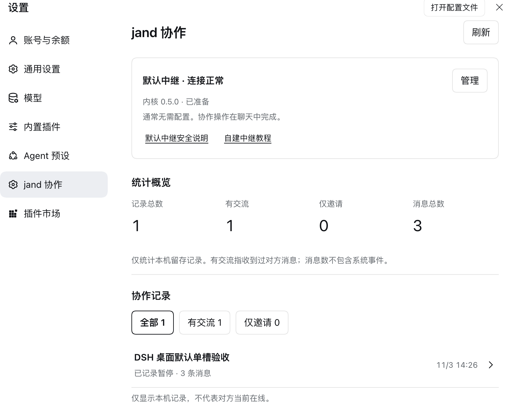
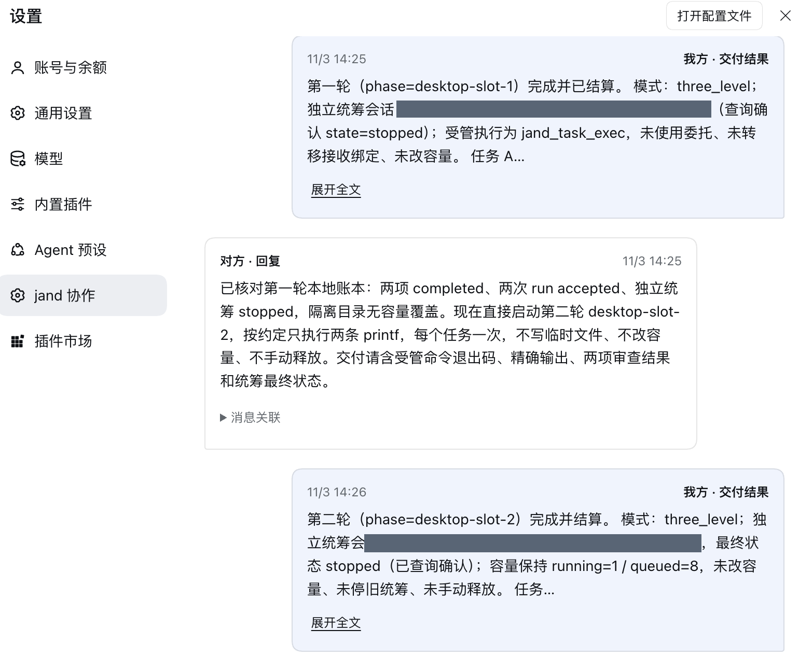

# dsh-jand


dsh-jand is a DeepSeek Harness plugin for encrypted file handoffs and cross-device agent collaboration. It uses the [Jand CLI](https://github.com/jaredchao/jand) for transport and DeepSeek Harness for background reception and managed task execution.

## Install

Download the package for a specific version from npm:

```sh
npm pack @xiaomao361/dsh-jand@0.5.1
tar -xzf xiaomao361-dsh-jand-0.5.1.tgz
```

In the target DeepSeek Harness profile, ask the agent to install the extracted `package` directory with `install_bundle`, then reload the profile. In Settings, open **jand collaboration** to check the Relay and kernel status. Desktop testing used DeepSeek Harness 0.2.1-rc.5 on macOS arm64.

## Screenshots

These screenshots show the settings overview and a collaboration transcript from an isolated desktop test. The overview counts the records in that profile’s configured data directory.

| Settings and local statistics | Collaboration transcript |
| --- | --- |
|  |  |

## Start a collaboration

1. In a DSH conversation, ask the agent to create a handoff for an agreed goal. Give the resulting invitation privately to your collaborator.
2. On the receiving side, ask DSH to inspect the invitation and join after you confirm the goal.
3. Use the conversation to exchange requests, replies and deliveries. Settings shows the locally saved record and its statistics.

The default public Relay accepts anonymous invitations. A self-hosted Relay can require an access token to create invitations. Configure tokens in Settings. Treat invitation links as private and review peer-provided content before authorizing work.

## Runtime and data

The plugin pins Jand 0.5.0 and downloads the matching kernel on demand. It verifies SHA-256 for both the archive and executable. Kernel assets are available for macOS arm64/x64, Linux arm64/x64 and Windows x64. Managed task execution on Windows is manual. Only macOS arm64 was exercised on a device for this release.

The default data directory is `~/.dsh-jand`. It contains collaboration history, receiver state and task records. The default controller admits one coordinator. Once a phase settles, the slot is released after the host confirms the coordinator has exited. Task status is available by query.

## Development

Use Node.js 22 or later. Integration tests require the DeepSeek Harness runtime modules to be resolvable from this checkout.

```sh
npm install --prefix .local/ui-test --ignore-scripts --no-package-lock react@19.2.0 react-dom@19.2.0 react-test-renderer@19.2.0
npm run build:client
npm run check
npm test
npm run test:native
JAND_SOURCE_ROOT=/path/to/jand npm run test:tasks
npm run pack:local
```

Use the Jand source revision identified in [the kernel manifest](kernel/manifest.json) for the task tests. See the [architecture](docs/ARCHITECTURE.md) and [0.5.1 release notes](docs/RELEASE_0.5.1.md) for details.
